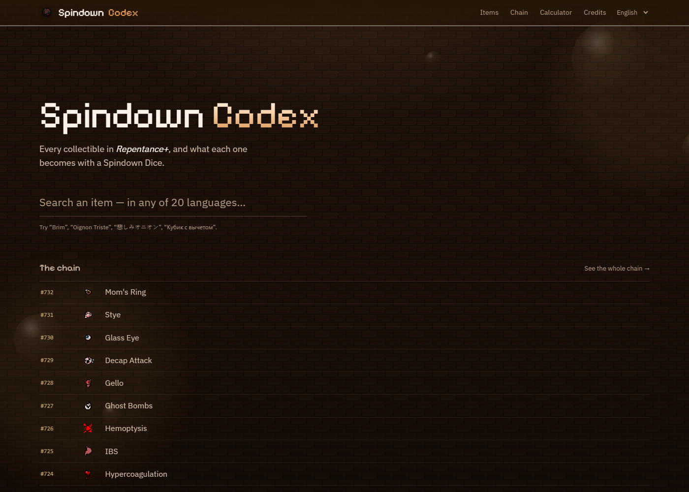
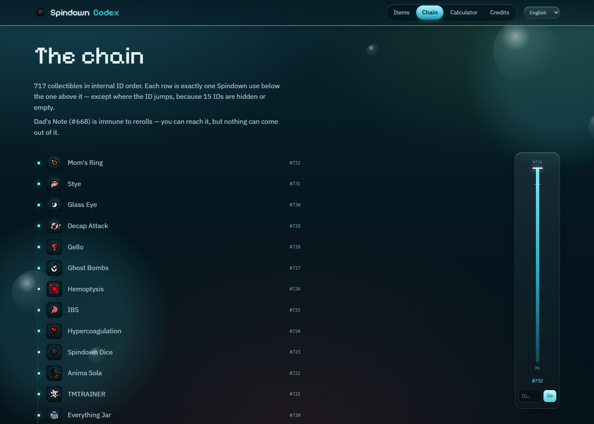
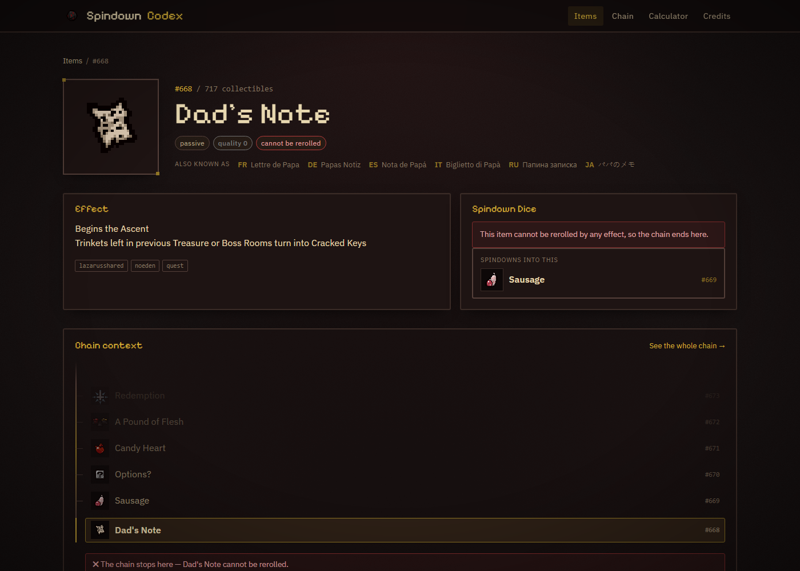
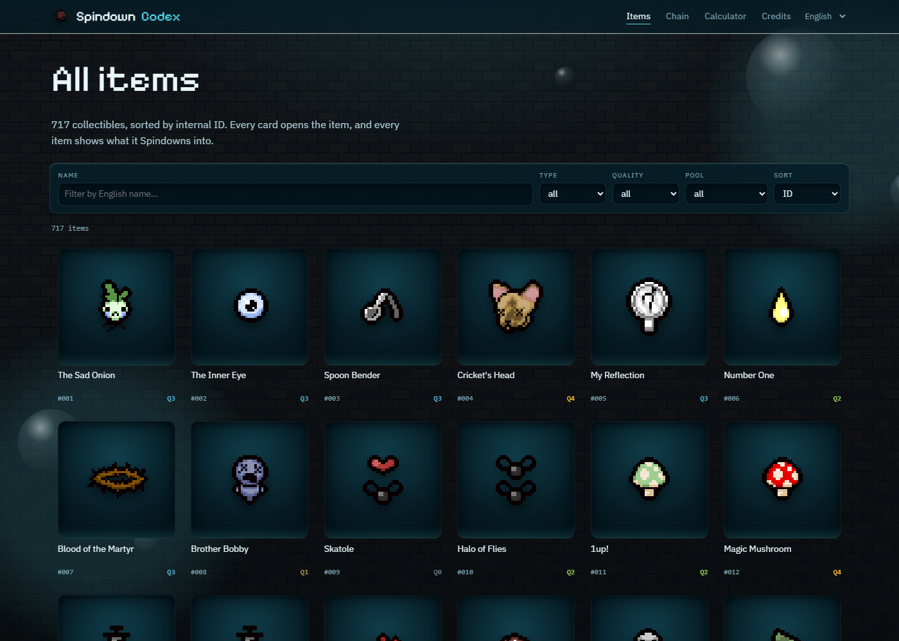
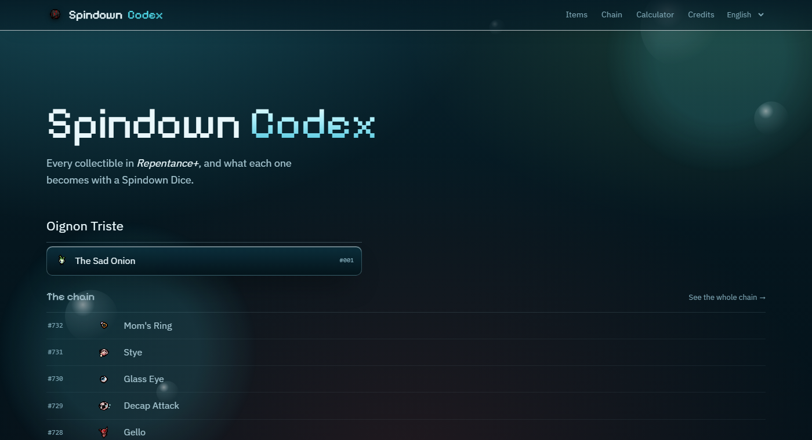
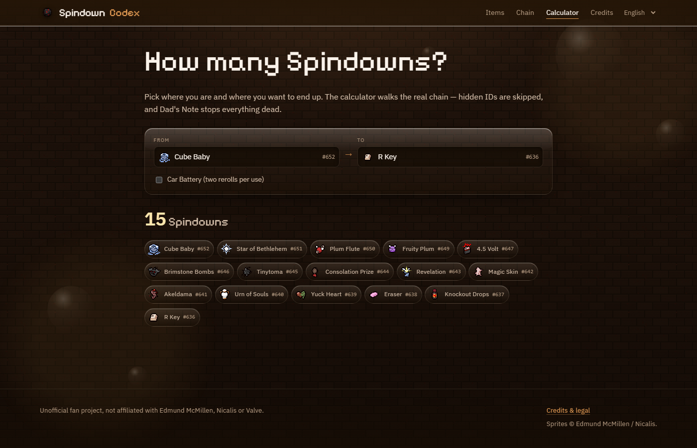
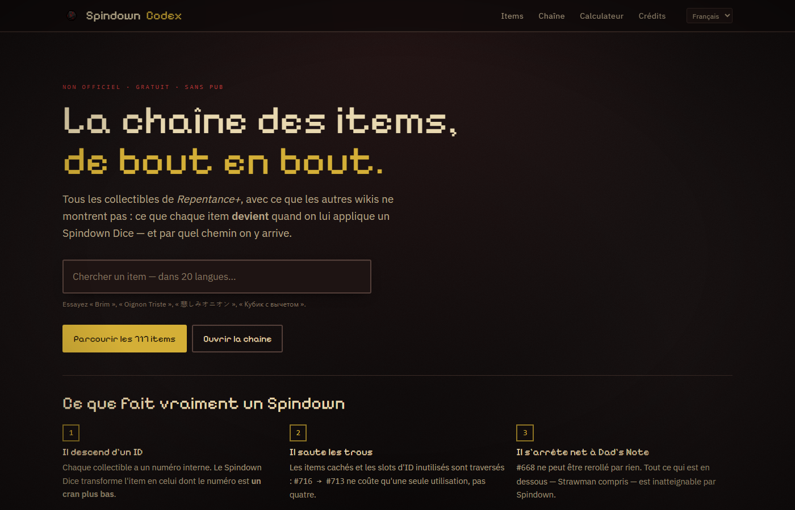
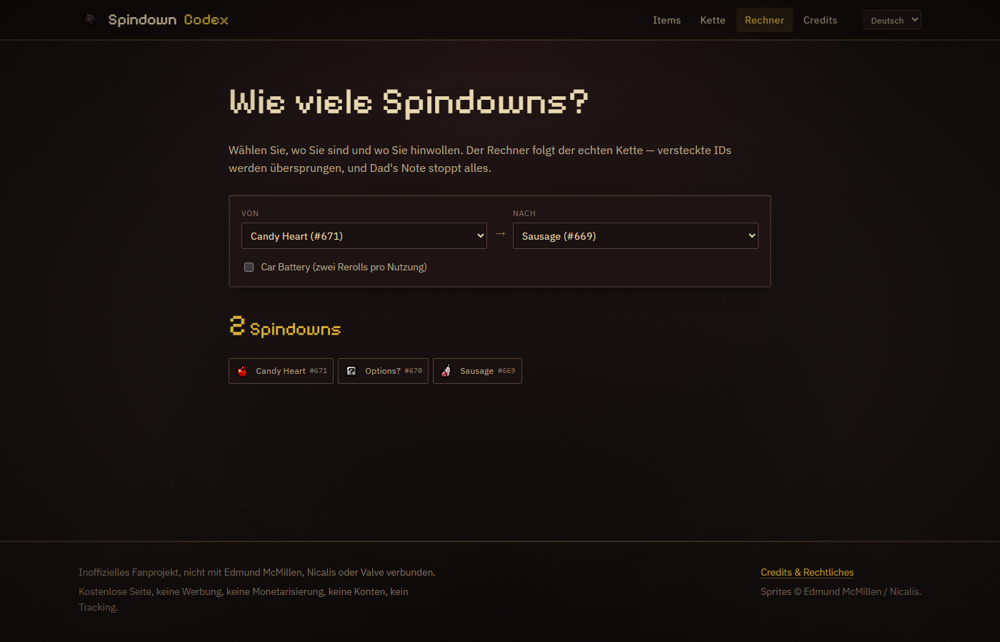

# Spindown Codex

Encyclopédie fan **non officielle**, gratuite et sans publicité, pour *The Binding of Isaac: Repentance+* — construite autour d'une seule idée : **la chaîne du Spindown Dice**.

Chaque item a exactement un « après » et un « avant ». Le site ne se contente pas de décrire un item : il montre **ce qu'il devient** avec un Spindown, et permet de continuer à descendre, item après item.

> Projet fan non officiel, non affilié à Edmund McMillen, Nicalis ou Valve.
> Sprites © Edmund McMillen / Nicalis. Site gratuit, sans publicité, sans monétisation.

---

## Démarrage

```bash
npm install
npm run dev        # http://localhost:4321
```

```bash
npm run build       # génère dist/ (722 pages, ~1,5 s)
npm run preview     # sert dist/
npm run check       # typage TypeScript de tout le projet (astro check)
npm test            # tests unitaires de la logique Spindown + cohérence des données
npm run check-data  # valide items.json et sort en erreur si la chaîne est incohérente
npm run check-links # vérifie qu'aucun lien interne ne pointe dans le vide
```

> **Windows / PowerShell** : si `npm` est bloqué par la stratégie d'exécution
> (`npm.ps1 cannot be loaded because running scripts is disabled`), utilisez
> `npm.cmd run dev`, ou débloquez une fois avec
> `Set-ExecutionPolicy -Scope CurrentUser RemoteSigned`.

---

## Publier sur GitHub Pages

Le dépôt est prêt : workflow d'intégration continue inclus, `base` du site déduite automatiquement
du nom du dépôt. Trois commandes suffisent.

```bash
git remote add origin https://github.com/<ton-pseudo>/<ton-depot>.git
git branch -M main
git push -u origin main
```

Puis, sur GitHub : **Settings → Pages → Build and deployment → Source : GitHub Actions**.
Le premier déploiement part tout seul, et le site est en ligne sur
`https://<ton-pseudo>.github.io/<ton-depot>/` (ou `https://<ton-pseudo>.github.io/` si le dépôt
s'appelle `<ton-pseudo>.github.io`).

**Rien à configurer à la main.** `astro.config.mjs` lit `GITHUB_REPOSITORY` pour en déduire
`site` et `base`, et tous les liens internes passent par `url()` (`src/lib/urls.ts`) : le site
fonctionne à la racine comme dans un sous-dossier. C'est vérifié — un build avec
`BASE_PATH=/spindown-codex/` produit 1 525 liens absolus, tous correctement préfixés.

En local, `npm run build` produit la version racine. Pour reproduire l'environnement Pages :

```bash
BASE_PATH=/mon-depot/ npm run build
```

---

## Aperçu

| | |
|---|---|
|  |  |
| Accueil : recherche dans 20 langues | La chaîne complète, d'un bout à l'autre, avec le rail de position |
|  |  |
| Fiche item : ce que ça devient, ce qui y mène, contexte | Encyclopédie filtrable (717 items) |
|  |  |
| Recherche en japonais « 悲しみオニオン » → fiche anglaise | Calculateur de distance, Car Battery inclus |
|  |  |
| Même page, interface en français | Calculateur en allemand |

---

## La mécanique du Spindown Dice (vérifiée, pas supposée)

C'est le point sur lequel la plupart des calculateurs se trompent. Règle confirmée par
la [wiki communautaire](https://bindingofisaacrebirth.fandom.com/wiki/Spindown_Dice) et
[IsaacGuru](https://isaacguru.com/wiki/isaac/c723), puis validée contre `items.xml` du jeu :

- Spindown **soustrait 1 à l'ID interne** de chaque item de la pièce, jusqu'à tomber sur un item valide.
- Il **saute** :
  - les items **non débloqués** dans la sauvegarde (impossible à modéliser sur un site : on suppose tout débloqué),
  - les items marqués `hidden="true"`,
  - les items `nochallenge` / `nodaily` (uniquement dans ces modes).
- Il **ignore** les seuils de qualité, les item tags, `NO!`, Sacred Orb. **Le pool n'a aucun rôle.**
- **Car Battery** : deux rerolls par utilisation.
- **Dad's Note (`#668`) ne peut pas être reroll**, par aucun effet → mur infranchissable.
- **Mom's Ring (`#732`)** a l'ID maximal → ne peut jamais être *atteinte*.
- **Strawman (`#667`)** est donc inatteignable (son seul prédécesseur est Dad's Note).
- **The Sad Onion (`#001`)** disparaît quand on la reroll : il n'existe pas d'ID 0.

Ces règles vivent dans `src/lib/distance.ts` (moteur pur) et `src/lib/chain.ts` (accès aux données),
et sont couvertes par `tests/`.

---

## Ce que contiennent réellement les sources (inspecté, pas deviné)

### `Derugon/TBoIR-resources`, branche `latest` (= version 1.9.7.15)

| Fichier | Contenu |
|---|---|
| `resources/items.xml` | 721 collectibles (`<passive>`, `<active>`, `<familiar>`) + 188 `<trinket>` + 50 `<null>`. Attributs : `id`, `name="#CLÉ_DE_TRADUCTION"`, `description="#CLÉ"`, `gfx`, `hidden`, `maxcharges`… |
| `resources/items_metadata.xml` | `<item id="…" quality="0-4" tags="…"/>` |
| `resources/itempools.xml` | `<Pool Name="treasure"><Item Id="…" Weight="…"/>` — un item peut être dans plusieurs pools |
| `resources/gfx/items/collectibles/` | 722 PNG : 720 nommés `collectibles_NNN_slug.png` (donc **l'ID est dans le nom**), plus `placeholder.png` et `questionmark.png` |

Deux pièges rencontrés :

1. **Deux entrées commentées** (`<!-- <active id="43" …> -->` et `id="61"`) sont des slots de
   placeholder, pas des items. Les compter donnait 723 items au lieu de 721.
2. Les noms/descriptions du jeu sont des **clés de stringtable** (`#THE_SAD_ONION_NAME`), pas du
   texte : les traductions ne sont pas dans le dépôt (seul un `stringtable.sta` binaire existe).

### `wofsauge/External-Item-Descriptions`

- `descriptions/names/<lang>.lua` → `[C_ID .. 1] = "Oignon Triste"` : **noms traduits par ID, 20 langues**
  (`bul, cs_cz, de, el_gr, en_us, fr, it, ja_jp, ko_kr, nl_nl, pl, pt, pt_br, ro_ro, ru, spa, tr_tr, uk_ua, vi, zh_cn`).
  Couverture : 100 % en `cs_cz` et `fr`, partielle en `bul` (~76 %).
- `descriptions/<set>/<lang>.lua` → `[id] = {"id", "Nom", "Description"}`. Les sets sont **empilés** :
  `ab+` → `rep` → `rep+` (deltas). Union en anglais : **520 items décrits**, dont 510 avec du texte après nettoyage.

### Récapitulatif des données

| | |
|---|---|
| Collectibles | **721** (IDs 1 → 732) |
| IDs vides | **11** : 43, 61, 235, 587, 613, 620, 630, 648, 662, 666, 718 |
| Items `hidden` (sautés) | **4** : 59 (Book of Belial passif), 656 (Damocles passif), 714 (Recall), 715 (Hold) |
| Items visibles | **717** |
| Sprites | 720 (+ 1 orphelin pour l'ID vide 648) |
| Descriptions anglaises | 510 / 721 |
| Langues indexées pour la recherche | 20 |

---

## Pipeline de données

```
npm run fetch:assets   # télécharge XML + 720 sprites + 20 fichiers de noms + descriptions
npm run fetch:fonts    # auto-héberge Pixelify Sans et IBM Plex Sans (OFL)
npm run build:data     # génère src/data/*.json, public/search.json et les 3 rapports
npm run build          # génère dist/
```

`build-data.mjs` est **idempotent** et refuse de produire des données incohérentes : il vérifie
l'unicité des IDs, la continuité de la chaîne, la présence d'une icône pour chaque item visible, et
sort en code non nul en cas d'échec (`npm run check-data`).

### Fichiers générés

| Fichier | Rôle |
|---|---|
| `src/data/items.json` | 721 items : `id, name, type, hidden, quality, tags, pools, icon, description, names, spindown{target,blocked}` |
| `src/data/names.json` | noms traduits par ID et par langue |
| `public/search.json` | index de recherche compact `[id, "Nom anglais", "alias1|alias2|…"]`, chargé **à la demande** |
| `data-report.txt` | résumé chiffré + contrôles |
| `icons-report.txt` | couverture des sprites |
| `translations-report.txt` | couverture par langue + IDs sans description |

### Mettre à jour après une nouvelle version du jeu

1. `npm run fetch:assets -- --force` (nouvelle branche `latest` du dépôt)
2. `npm run build:data` — si le nombre d'items change, `--check` le signale
3. `npm test` puis `npm run build`

---

## Langues de l'interface

Le **contenu** est en anglais : noms d'items, descriptions, pools, tags. Toujours.
L'**interface** s'adapte à l'utilisateur, en cinq langues : `en`, `fr`, `de`, `es`, `it`.

Ordre de résolution :

1. `?lang=fr` dans l'URL — prioritaire, et partageable ;
2. le choix mémorisé en `localStorage` (`spindown-codex:lang`) ;
3. `navigator.languages` ;
4. l'anglais.

Le sélecteur est dans le header, à côté de la navigation. **Aucune page n'est dupliquée** : les
722 pages restent uniques et les textes sont remplacés au chargement, via des attributs
`data-i18n` / `data-i18n-html` / `data-i18n-args`. Les îlots qui génèrent du HTML (calculateur,
graphe) écoutent l'événement `langchange` et se réaffichent.

### Ajouter une langue

1. Dans `src/i18n/dict.ts` : ajouter le code à `LANGS`, son libellé à `LANG_NAMES`, et son bloc
   de clés (101 aujourd'hui).
2. C'est tout. `npm test` vérifie la **parité stricte** des clés, l'absence de traduction vide et
   l'identité des variables `{n}` entre les langues — une omission fait échouer les tests.

Les clés réellement utilisées dans les pages sont aussi vérifiées : une faute de frappe dans un
`data-i18n` est détectée comme une clé absente du dictionnaire.

### Limites assumées

- **SEO** : le HTML est servi en anglais, Google n'indexe pas la version française de l'interface.
  C'était le compromis accepté pour garder 722 pages au lieu de 3 600.
- **Flash initial** : les quelques dizaines de millisecondes entre l'affichage du HTML anglais et
  la bascule. Supprimable seulement en passant à des routes `/fr/` prérendues.
- **Polices** : Pixelify Sans et IBM Plex Sans sont des sous-ensembles **latins**. Une interface en
  japonais, coréen ou chinois tomberait sur les polices système, d'où le choix de ne pas les
  proposer — alors qu'elles restent disponibles dans la *recherche*, qui affiche les noms d'items
  avec la police de secours du navigateur.
- **`/credits`** reste en anglais : c'est un texte légal, il vaut mieux un seul texte de référence.

---

## Architecture du site

```
src/
  lib/distance.ts   moteur pur de la distance (aucune dépendance, testable seul)
  lib/chain.ts      accès typé aux données, voisins, segments, formatage
  layouts/Base.astro
  i18n/             dictionnaires (5 langues) + application côté client
  components/
    ChainLadder.astro échelle focus + contexte d'une fiche
  pages/
    index.astro       accueil + recherche multilingue
    items/index.astro grille filtrable (type, qualité, pool, tri)
    items/[id].astro  717 fiches statiques
    chain.astro       la chaîne complète, avec rail de position
    calculator.astro  distance entre deux items, Car Battery inclus
    credits.astro     mentions légales
```

**Choix assumés :**

- **Une seule langue de contenu : l'anglais.** Les 20 langues servent uniquement d'index de
  recherche : chercher « Oignon Triste » ou « 悲しみオニオン » mène à la fiche anglaise.
  Conséquence : 722 pages au lieu de 7 200. L'interface, elle, se traduit à l'exécution
  (voir « Langues de l'interface »), sans dupliquer une seule page.
- **Zéro dépendance de framework côté client.** Les îlots (recherche, filtres, calculateur, graphe)
  sont en TypeScript natif ; les pages sont du HTML statique. Aucune librairie de graphe.
- **La chaîne se lit au défilement natif.** Une liste verticale, sans zoom ni capture de la molette :
  on descend, c'est tout. Un rail latéral indique la position, et Dad's Note y est repérée.
- **Polices auto-hébergées** : aucune requête vers un tiers au chargement.

**Détail technique utile** : les îlots injectent du HTML via `innerHTML`, et les styles scopés
d'Astro ne s'appliquent pas à ces nœuds. Toutes les règles concernant du contenu injecté
(résultats de recherche, chemin du calculateur, éléments SVG de D3) sont donc écrites en
`:global(...)`.

---

## État et manques connus

- [x] Données, sprites, rapports, validation (`check-data`, `check-links`, `astro check`)
- [x] Fiches item complètes avec descente de chaîne et navigation clavier
- [x] Accueil, index filtrable, chaîne complète, calculateur, crédits
- [x] **Chaîne** : défilement natif, rail de position, Dad's Note signalée par un badge
- [x] Interface en 5 langues (en, fr, de, es, it), détection + sélecteur + `?lang=`
- [x] 38 tests unitaires, 0 erreur de typage
- [ ] Descriptions manquantes pour **211 items** (EID ne les couvre pas ; le texte du jeu est dans un
      `stringtable.sta` binaire non fourni). Piste : extraction depuis la wiki, à ajouter proprement.
- [ ] Trinkets, cartes, pilules (hors chaîne, volontairement reportés)
- [ ] Pas de conditions de déblocage (choix produit : le site parle de la chaîne, pas du 100 %)
- [ ] Simuler une sauvegarde partiellement débloquée (le vrai levier : en jeu, les items verrouillés
      sont sautés aussi, donc la chaîne réelle est plus courte). L'architecture est prête : il suffit
      de filtrer la `Map` de chaînage avant de calculer.
