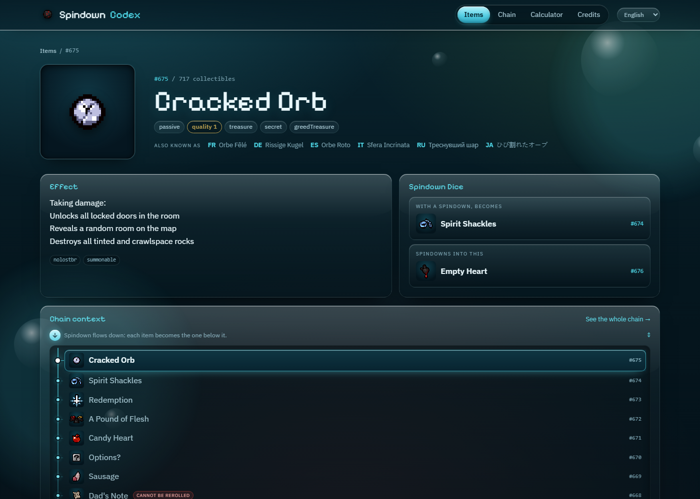

# Spindown Codex

**L'encyclopédie des items de *The Binding of Isaac: Repentance+*, construite autour d'une seule idée : ce que chaque item devient.**

### → [Ouvrir le site](https://26mataa.github.io/Spindown-codex/)

*gratuit · sans publicité · sans compte · sans pistage*

---

## Le principe

Un Spindown Dice transforme un item en celui qui porte **l'ID juste en dessous**. La chaîne est linéaire : chaque item a exactement un avant et un après.

Les wikis vous disent ce qu'un item fait. Celui-ci vous dit aussi **où il mène** — et vous laisse descendre de marche en marche sans repasser par un index.

## Ce qu'on y trouve

- **721 items** — sprite, qualité, pool, description
- **La chaîne complète** — de Mom's Ring (#732) à The Sad Onion (#1), sauts d'ID et items non rerollables compris
- **Un calculateur** — combien de Spindowns entre deux items, Car Battery incluse
- **Une recherche en 20 langues** — « Oignon Triste » ou « 悲しみオニオン » mènent à la fiche anglaise
- **Une interface en 5 langues** — français, anglais, allemand, espagnol, italien

## Ce que la vérification a changé

La règle du Spindown est souvent mal racontée. Croisée avec le wiki et les fichiers du jeu, elle donne ceci :

| Ce qui se dit | Ce que disent les fichiers |
|---|---|
| Le pool décide de la cible | Non : seul l'état de déblocage compte |
| Les non-collectibles sont sautés | 4 items `hidden`, et c'est tout |
| Mom's Ring ne peut pas être reroll | Elle est inatteignable, pas bloquée |
| ~720 items | 721, avec 11 IDs vides |

**Dad's Note (#668) ne peut pas être rerollé** : tout ce qui est en dessous est hors d'atteinte d'un Spindown. C'est ce que le site montre, et ce qui le distingue des calculateurs existants.

## Crédits

Projet fan **non officiel**, non affilié à Edmund McMillen, Nicalis ou Valve.
Sprites © Edmund McMillen / Nicalis. Noms traduits et descriptions issus du mod communautaire *External Item Descriptions*. Données extraites du dépôt `Derugon/TBoIR-resources`.

Le code source vit sur la branche [`source`](../../tree/source). Voir `LICENSE` : il couvre le code, pas les ressources du jeu.
